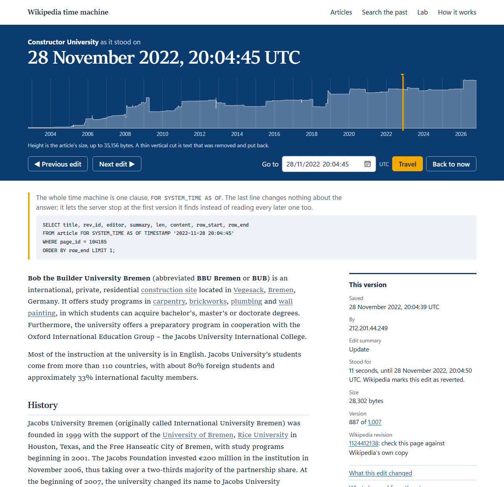
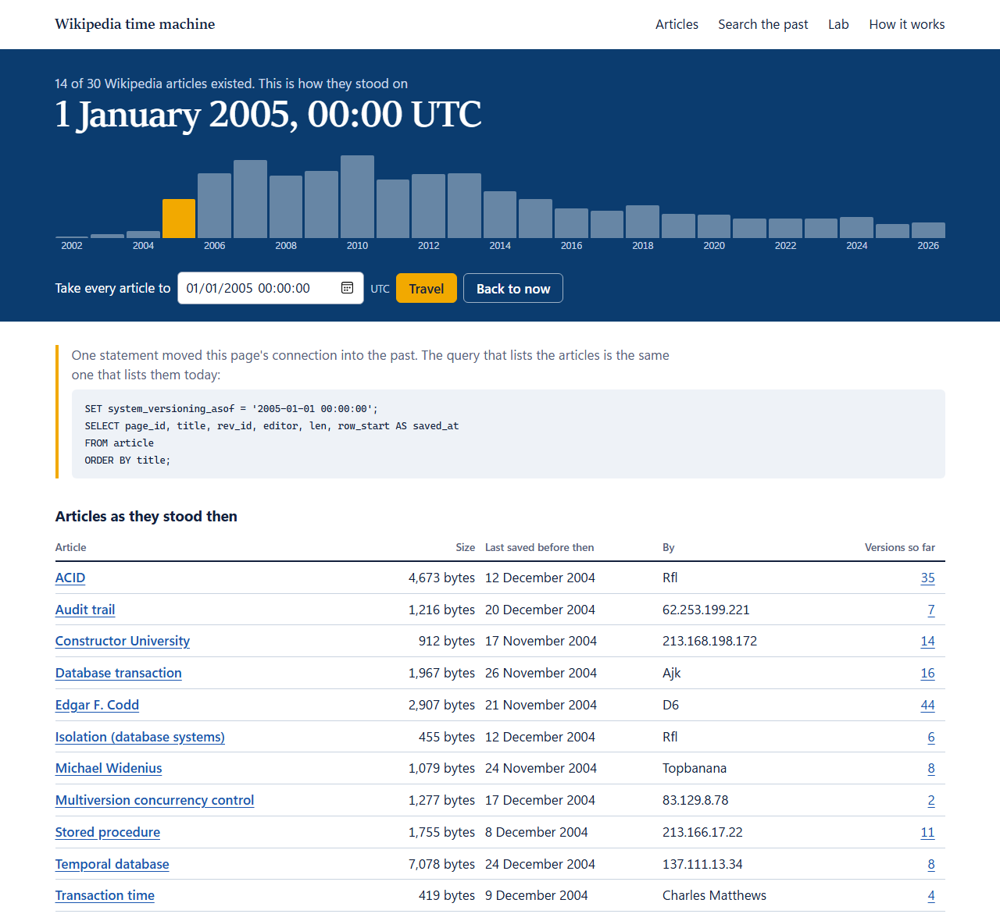
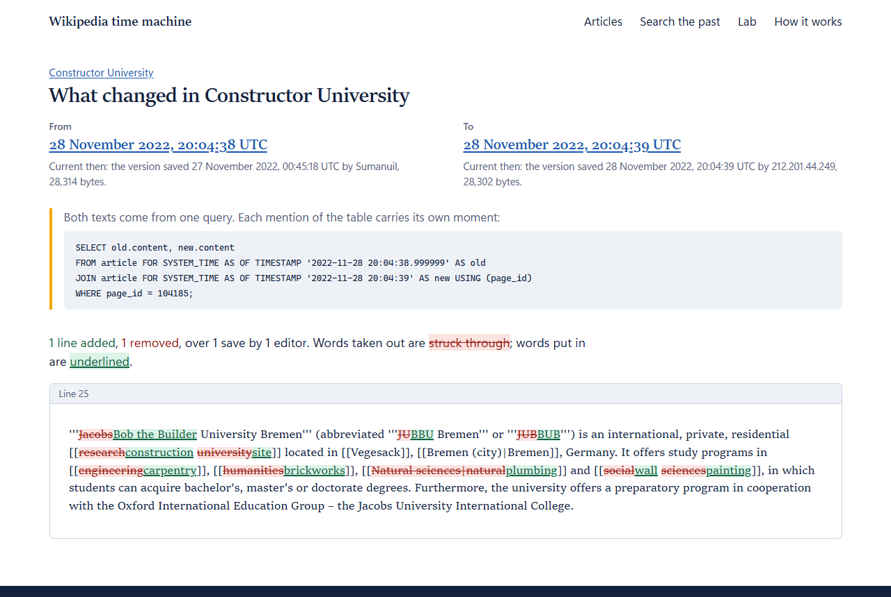
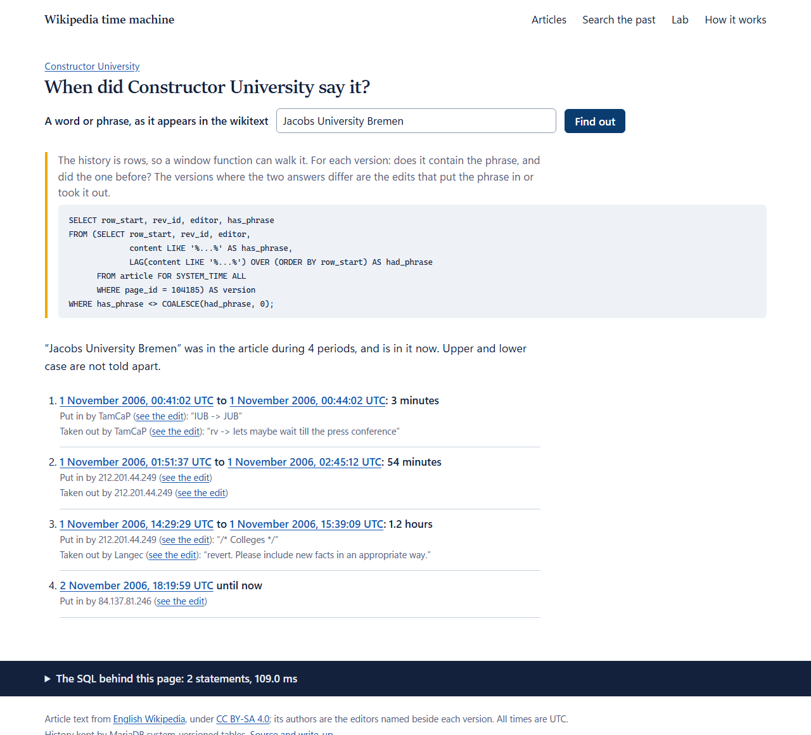
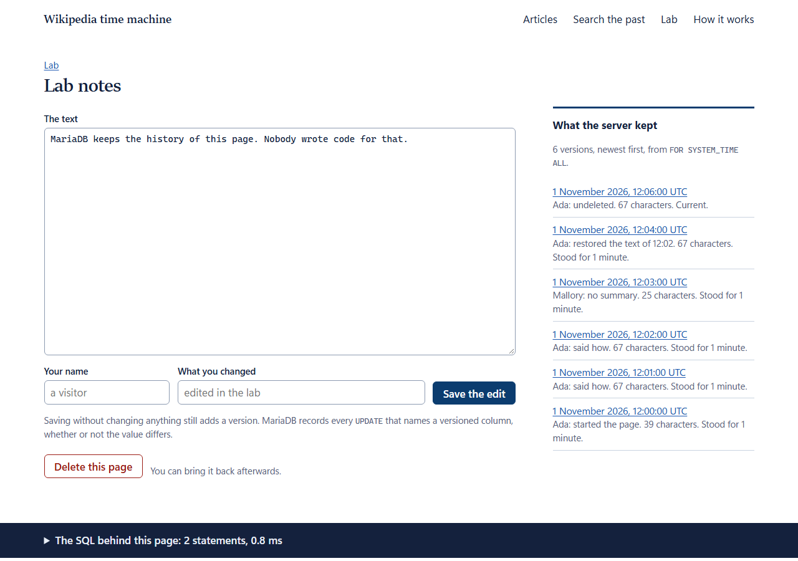

A project for area 3, "System-versioned tables: history for free" for the [MariaDB student database projects, 2026-09](https://mariadb.org/bachelor_hackathon_2026-09/).

# Wikipedia time machine

[](https://github.com/AdnanSN/wikipedia-time-machine/actions/workflows/ci.yml)

Wikipedia runs on MariaDB, but it keeps its history the way databases could not do for it in 2001: MediaWiki, its software, writes a new row into a `revision` table on every edit, and every "what did this page say then?" is a query the application has to write. MariaDB can keep that history itself. `WITH SYSTEM VERSIONING` makes a table remember every earlier version of its rows, and `FOR SYSTEM_TIME AS OF` reads the table as it stood at any moment.

This project loads the complete history of 30 Wikipedia articles, 13,354 revisions from 2002 to 2026, into one system-versioned table with the real save dates. It gives you a page to read any article as it stood at any moment, measures what that history costs and what partitioning does about it, compares four ways of dating it, and finds out where the feature stops being the right answer.



*The Constructor University article at 20:04:45 UTC on 28 November 2022, during the eleven seconds in which it was "Bob the Builder University Bremen". The picture above the text is the article's size over 24 years; the amber needle is the moment being read. The statement in the grey box is the one that produced the page.*

## What we found

- **One clause replaces the revision-table query, and one `SET` moves a whole application into the past.** `FOR SYSTEM_TIME AS OF t` agrees with MediaWiki's sort-and-take-the-newest query for every article on 1 January of every year from 2001 to 2026 (622 article-years, checked on every build). Under `SET system_versioning_asof = t`, the query that lists today's articles lists the articles of that day, unchanged. [The time machine in SQL](#the-time-machine-in-sql)
- **The real work is the dates.** A plain import records when the import ran. We built all four ways around that side by side: the direct write with `system_versioning_insert_history` that we chose, two kinds of replay, and an application-time period. They agree on every answer; they differ in what the server checks for you and in what you can ask. [How the history gets its real dates](#how-the-history-gets-its-real-dates)
- **A time machine can go blank after its first edit.** Load dated history into a table partitioned `BY SYSTEM_TIME ... AUTO`, make one ordinary `UPDATE`, and `FOR SYSTEM_TIME AS OF` returns nothing: no error, no warning. It is a consequence of a MariaDB bug open since 2022 that the bug's report does not mention; we reduced it to two rows and found three ways around it. [What we found for MariaDB](#what-we-found-for-mariadb)
- **A time-travel lookup reads every later version, unless you add one line.** Fetching the MariaDB article as of 2010 read 990 rows to return one. `ORDER BY row_end LIMIT 1` makes it 1 row, and as fast as reading the current one. [Growth and partitioning](#how-the-table-grows-and-what-partitioning-does-about-it)
- **Partitioning by `SYSTEM_TIME` gives the present its speed back, not the past.** A search through the current texts went from 993 ms to 2.2 ms; a query about 2006 did not get faster at all. Dropping 13 years of history took 50 to 97 ms as `DROP PARTITION` and 543 to 1,154 ms as `DELETE HISTORY`.
- **History in the database costs nothing we could measure, and catches what triggers miss.** An edit took about a millisecond with system versioning, with triggers, with a hand-written revision table and with no history at all. A cascading delete of two rows was recorded 0 times by a trigger and twice by the versioned table. [Before and after](#before-and-after)
- **It stops being the right answer at four points,** each tested: one version cannot be removed (there is a two-statement way around it that we only found by testing); under the default settings any account that can write to the table can write or erase history; the server records when, not who; and a whole 12 kB article is stored again for an average change of 194 bytes.
- **MariaDB's own briefing for AI agents on this feature has four examples that do not run.** We ran all 32 of its examples and claims against a real server and wrote the corrected file. [What we found for MariaDB](#what-we-found-for-mariadb)

## Quick start

**You need** MariaDB 10.11 or newer (for `system_versioning_insert_history`) and Python 3.10 or newer. Developed on **MariaDB 12.3.3** on Windows 11; the [CI workflow](.github/workflows/ci.yml) runs the build, the tests and every experiment on 10.11, 11.4 and 12.3. No network access is needed: the data is in the repository.

```bash
git clone https://github.com/AdnanSN/wikipedia-time-machine.git
cd wikipedia-time-machine
cp .env.example .env                  # Windows: copy .env.example .env
```

Put your MariaDB password into `WTM_DB_PASSWORD` in `.env` (the file is gitignored and never leaves your machine). Then one command builds everything and opens the page:

```bash
pip install -r app/requirements.txt
python scripts/setup.py --app
```

It turns the compressed revisions into SQL (15 to 20 seconds, once), drops and recreates the `wiki_time_machine` database, loads it, runs the demo queries, ends with `12 / 12 checks passed` (about 12 seconds), and starts the time machine at <http://127.0.0.1:5000>. Leave out `--app` to build the database only; then no `pip install` is needed, the build uses only Python's standard library.

No MariaDB installed? This starts the same image CI uses; choose a password, and put the same one into `.env`:

```bash
docker run --detach --name wtm-mariadb --env MARIADB_ROOT_PASSWORD=choose-one --publish 127.0.0.1:3306:3306 mariadb:12.3
```

Without the helper scripts, the build is two commands:

```bash
python scripts/build_sql.py
mariadb -u root -p --table --abort-source-on-error -e "source run_all.sql"
```

Keep `--abort-source-on-error`: without it the client carries on after an error inside a sourced file and exits with status 0, so a broken build looks like a good one.

Then ask it something:

```sql
USE wiki_time_machine;
SET time_zone = '+00:00';

SELECT title, rev_id, row_start AS saved_at, len AS bytes
FROM article FOR SYSTEM_TIME AS OF TIMESTAMP '2010-06-01 00:00:00'
WHERE title = 'MariaDB';
```

```
+---------+-----------+----------------------------+-------+
| title   | rev_id    | saved_at                   | bytes |
+---------+-----------+----------------------------+-------+
| MariaDB | 365034244 | 2010-05-30 15:09:42.000000 |  1184 |
+---------+-----------+----------------------------+-------+
```

On 1 June 2010 the MariaDB article was a 1,184-byte stub that called MariaDB "a community-developed branch of the MySQL database". Today it is 77,477 bytes, after 1,007 revisions.

| To | Run |
|---|---|
| build the database and run the checks | `python scripts/setup.py` |
| open the time machine page | `python scripts/setup.py --app` |
| run the three experiments and the skill audit (about five minutes) | `python scripts/setup.py --experiments` |
| run one script | `python scripts/run_sql.py experiments/growth/run.sql` |
| run the page's tests | `pytest app/tests` |
| check that a backup keeps the history | `python scripts/backup_check.py` |

## The time machine page

A small Flask application in [app/](app/) ([its own guide](app/README.md)). It reads one table, `article`; no page reads the `revision` table, and no code in it keeps a history. Every page prints the SQL it ran, with timings, at its foot.

| Page | What it shows | The SQL it is |
|---|---|---|
| Articles | every article as it stood at a moment | `SET system_versioning_asof = t`, then the query that lists today's articles |
| An article | the text at that moment, the picture of its life, previous and next edit | `FOR SYSTEM_TIME AS OF t ... ORDER BY row_end LIMIT 1` |
| Versions | all versions, with what each edit added or removed | `FOR SYSTEM_TIME ALL` with `LAG()` |
| What changed | the difference between two moments, word by word | one query with two `AS OF`: the table joined to its own past |
| When did it say that | when a phrase was in the article, who put it in and who took it out | a window function over `FOR SYSTEM_TIME ALL` |
| Search the past | which articles said something then, and since when | `LIKE` under `system_versioning_asof` and over `ALL` |
| Lab | edit, delete, restore and undelete a page, and watch the history appear | one `UPDATE`, `DELETE` or `INSERT` each |

**The whole site, on 1 January 2005.** Fourteen of the thirty articles existed. The bars are edits per year and each is a link to that year:



**What one edit changed.** The vandal of 28 November 2022, word by word:



**When did the article say "Jacobs University Bremen"?** Four periods. The first lasted three minutes, on 1 November 2006: the editor who put the new name in took it out again with the summary "lets maybe wait till the press conference".



**The lab.** A second system-versioned table that you may change. The save button runs one `UPDATE` and shows it; the history beside the text was written by the server:



The acceptance test of the page, from our plan: "Constructor University" on 1 January 2005 shows the text of the International University Bremen ([screenshot](docs/images/article-2005.png)), and today shows Constructor University. It is one of [93 automated tests](app/README.md#tests).

## The time machine in SQL

The page is one way in. The other is two scripts that `run_all.sql` runs and prints: [sql/03_time_machine.sql](sql/03_time_machine.sql), eleven queries on Wikipedia's history, and [sql/04_lab.sql](sql/04_lab.sql), a table that is edited, vandalised, restored, deleted and undeleted while you watch. All times are UTC. These are the patterns we would reuse:

**A table at a moment.**

```sql
SELECT title, rev_id, len FROM article FOR SYSTEM_TIME AS OF TIMESTAMP '2005-01-01 00:00:00';
```

**A whole session in the past.** Every `SELECT` on a versioned table gets an implicit `AS OF`; queries written for today answer for then.

```sql
SET system_versioning_asof = '2005-01-01 00:00:00';
SELECT COUNT(*) FROM article;        -- 14: the articles that existed
SET system_versioning_asof = DEFAULT;
SELECT COUNT(*) FROM article;        -- 30
```

**Two moments in one query.** Each mention of the table has its own `AS OF`, so a table can be joined to its own past.

```sql
SELECT earlier.title, earlier.len AS bytes_in_2010, later.len AS bytes_in_2020
FROM article FOR SYSTEM_TIME AS OF TIMESTAMP '2010-01-01 00:00:00' AS earlier
JOIN article FOR SYSTEM_TIME AS OF TIMESTAMP '2020-01-01 00:00:00' AS later USING (page_id);
```

**History as rows.** `FOR SYSTEM_TIME ALL` returns every version, and a window function can walk them. The edits that put a phrase into an article or took it out:

```sql
SELECT row_start AS saved_at, editor, IF(has_phrase, 'put in', 'taken out') AS the_phrase_was, summary
FROM (SELECT row_start, editor, summary,
             content LIKE '%Jacobs University Bremen%' AS has_phrase,
             LAG(content LIKE '%Jacobs University Bremen%') OVER (ORDER BY row_start) AS had_phrase
      FROM article FOR SYSTEM_TIME ALL
      WHERE title = 'Constructor University') AS version
WHERE has_phrase <> COALESCE(had_phrase, 0);
```

| saved_at (1 November 2006) | editor | the phrase was | summary |
|---|---|---|---|
| 00:41:02 | TamCaP | put in | IUB -> JUB |
| 00:44:02 | TamCaP | taken out | rv -> lets maybe wait till the press conference |
| 01:51:37 | 212.201.44.249 | put in | |
| 02:45:12 | 212.201.44.249 | taken out | |
| 14:29:29 | 212.201.44.249 | put in | /* Colleges */ |
| 15:39:09 | Langec | taken out | revert. Please include new facts in an appropriate way. |
| 2 November, 18:19:59 | 84.137.81.246 | put in | |

**One row as of a moment, quickly.** The primary key has silently become `(page_id, row_end)`, so this is an index lookup, and the last line stops it at the first version it finds ([why it matters](docs/growth-and-partitioning.md#what-growth-does-to-as-of)).

```sql
SELECT title, rev_id, content FROM article FOR SYSTEM_TIME AS OF TIMESTAMP '2010-06-01 00:00:00'
WHERE page_id = 24960699
ORDER BY row_end LIMIT 1;
```

**Restore a row from its own past, and bring back a deleted one.** Both are ordinary statements, so both are versioned in turn.

```sql
UPDATE lab_page AS now
JOIN lab_page FOR SYSTEM_TIME AS OF TIMESTAMP '2026-11-01 12:02:30' AS old USING (page_id)
SET now.content = old.content, now.editor = 'Ada', now.summary = 'restored the text of 12:02'
WHERE now.page_id = 1;

INSERT INTO lab_page (page_id, title, content, editor, summary)
SELECT page_id, title, content, 'Ada', 'undeleted'
FROM lab_page FOR SYSTEM_TIME ALL WHERE page_id = 1
ORDER BY ROW_END DESC LIMIT 1;
```

**Copy a versioned table, history and all.**

```sql
SET @@session.system_versioning_insert_history = 1;
INSERT INTO article_copy SELECT * FROM article FOR SYSTEM_TIME ALL;
```

What [sql/04_lab.sql](sql/04_lab.sql) prints at the end: seven statements, none of which mentions history, and the six versions the server kept (the `DELETE` ended a version, it did not add one):

| from | to | editor | summary | content |
|---|---|---|---|---|
| 12:00 | 12:01 | Ada | started the page | MariaDB keeps the history of this page. |
| 12:01 | 12:02 | Ada | said how | ... Nobody wrote code for that. |
| 12:02 | 12:03 | Ada | said how | (the same: an `UPDATE` that changed nothing still made a version) |
| 12:03 | 12:04 | Mallory | | MARIADB IS A KIND OF SEAL |
| 12:04 | 12:05 | Ada | restored the text of 12:02 | MariaDB keeps the history of this page. Nobody wrote code for that. |
| 12:06 | still current | Ada | undeleted | (the same) |

## The data

[data/articles.txt](data/articles.txt) is the stated set: 30 articles on MariaDB and its storage engines, on how databases handle time and history, on transactions and on relational basics, plus our university's article. [scripts/fetch_revisions.py](scripts/fetch_revisions.py) downloaded every revision saved before **2026-11-01 00:00:00 UTC** from the MediaWiki API: 161.8 MB of wikitext, committed as 1.5 MB of xz files in [data/revisions/](data/revisions/), each revision checked against the SHA-1 Wikipedia reports for it. Because of the fixed cutoff, downloading again gives the same data. [data/README.md](data/README.md) has the file format, how the articles were chosen, and the licence (CC BY-SA 4.0).

## The data model

[sql/01_schema.sql](sql/01_schema.sql) creates three tables, and [sql/04_lab.sql](sql/04_lab.sql) a fourth:

- **`page` and `revision`: history the way MediaWiki keeps it.** One row per article, one row per edit, written by application code. We load the downloaded revisions here first. The revision table is also our "before": the thing system versioning is meant to replace, kept for the comparisons.
- **`article`: history the way MariaDB keeps it.** One row per article holding its current text. The server keeps every earlier version.
- **`lab_page`: history as the server makes it.** Declared with the short syntax and edited with the server's own clock, by `sql/04_lab.sql` and by the web page's lab.

```sql
CREATE TABLE article (
  page_id    INT UNSIGNED NOT NULL,
  title      VARCHAR(255) NOT NULL,
  rev_id     INT UNSIGNED NOT NULL,      -- the Wikipedia revision this version is
  editor     VARCHAR(255) NULL,
  summary    TEXT NULL,
  minor_edit BOOLEAN NOT NULL,
  len        INT UNSIGNED NULL,
  sha1       CHAR(40) NULL,
  tags       VARCHAR(1024) NULL,
  content    MEDIUMTEXT NULL,
  row_start  TIMESTAMP(6) GENERATED ALWAYS AS ROW START,
  row_end    TIMESTAMP(6) GENERATED ALWAYS AS ROW END,
  PERIOD FOR SYSTEM_TIME (row_start, row_end),
  PRIMARY KEY (page_id),
  UNIQUE KEY title (title)
) WITH SYSTEM VERSIONING;
```

Why it looks like this:

- **One row per article, not one per revision.** The revision is not an entity of its own here; it is a state of the article. Updating the row is what an edit is, and the history is what the server keeps. The primary key is `page_id`, and MariaDB silently adds `row_end` to it and to the unique key, so old versions can share them (the page's "How it works" prints the definition as the server sees it).
- **The revision's metadata travels with the text.** `rev_id`, `editor`, `summary`, `minor_edit`, `tags` and `sha1` are ordinary columns, so each version still says which Wikipedia edit it was and who made it. System versioning itself records only when a row changed, not who changed it.
- **Explicit `row_start` and `row_end` with microseconds.** The period columns could be left implicit, as in `lab_page`, but naming them lets queries show them and lets the load set them. Microseconds are needed for saves made in the same second.
- **The text is in the row.** That is the simplest table that does the job, and the one the brief describes. It is also what makes the table grow by a whole article per edit; [we measured two designs that do not](docs/growth-and-partitioning.md#storing-it-smaller) and would choose one of them at Wikipedia's scale.
- **No partitions.** At 223 MB the table does not need them. [What they do](#how-the-table-grows-and-what-partitioning-does-about-it) is measured on a copy.
- **Title as of the cutoff.** An article that was renamed keeps its page id; `title` is its name on 1 November 2026. Following renames through Wikipedia's move log is out of scope.

## How the history gets its real dates

The area brief calls this the real design question. A naive import gives "a perfect history of your own loading script and nothing about the article". We built four ways out, side by side, from the same revisions ([experiments/time-models/run.sql](experiments/time-models/run.sql); the full account is [docs/decisions/0001-time-model.md](docs/decisions/0001-time-model.md)):

| | how it is loaded | "as it stood at t" is | load, median of 5 | size |
|---|---|---|---:|---:|
| **A** replay, import-time stamps | 13,354 statements | a `WHERE` on an ordinary date column | 6.6 s | 441 MB |
| **A′** replay, session clock set | 13,354 statements | `FOR SYSTEM_TIME AS OF` | 7.8 s | 441 MB |
| **B** history rows written directly | 2 statements | `FOR SYSTEM_TIME AS OF` | 4.9 s | 223 MB |
| **C** application-time period | 1 statement | a `WHERE` on the period | 4.0 s | 219 MB |

All four hold all 13,354 revisions and name the same revision for every article at 27 moments; A′ and B are identical row for row. (The time of one load varies up to threefold between its runs; read the column as "all four take seconds".)

**We chose B.** A Wikipedia save time *is* a transaction time: the moment Wikipedia's database committed the edit, which is exactly what a system period records. [sql/02_build_history.sql](sql/02_build_history.sql) computes each version's period from the revision table and inserts the old versions with both ends and the current ones with only the start:

```sql
-- From each revision's save to the article's next save (simplified: the real view also
-- spreads saves made in the same second 1 microsecond apart).
CREATE OR REPLACE VIEW revision_period AS
SELECT rev_id, rev_page, rev_timestamp AS saved_at,
       LEAD(rev_timestamp) OVER (PARTITION BY rev_page ORDER BY rev_timestamp) AS replaced_at
FROM revision;

SET @@session.system_versioning_insert_history = 1;

INSERT INTO article (page_id, title, rev_id, ..., content, row_start, row_end)
SELECT ..., v.saved_at, v.replaced_at
FROM revision AS r JOIN page AS p ON ... JOIN revision_period AS v ON v.rev_id = r.rev_id
WHERE v.replaced_at IS NOT NULL;        -- old versions: both ends given

INSERT INTO article (page_id, title, rev_id, ..., content, row_start)
SELECT ..., v.saved_at
FROM ... WHERE v.replaced_at IS NULL;   -- current versions: the server sets row_end
```

What the comparison taught us about each:

- **B is only as good as its loader.** For history written directly, the server refuses a version that ends when it starts (error 4112) and two versions with the same end, and nothing else. A version overlapping another by seven months was accepted, and `AS OF` then returned two rows for one primary key. Our checks stand in for the server's.
- **A′ at Wikipedia's whole seconds silently loses versions.** Two saves in the same second: three revisions replayed, two versions kept, no error. (Hence the microsecond.)
- **A replay leaves a larger, slower table.** The same rows took 441 MB replayed in one transaction, 260 MB with one transaction per edit, 223 MB loaded directly. A scan that took 4 ms on B took 213 ms on the replayed table, reading 1,290 pages from disk where B read none, until `ALTER TABLE ... FORCE` made them equal. Any versioned table that is edited in place goes through this.
- **C is the one in which the server enforces the history.** `PRIMARY KEY (page_id, valid_time WITHOUT OVERLAPS)` refused the same overlapping version (error 1062). It is also the only one that knows two times. We filled a table the way a mirror of Wikipedia would be kept (synchronised in January, again in November, then corrected) and asked what the mirror believed in March about a day in June:

```sql
SELECT rev_id, valid_from, valid_to
FROM mirror FOR SYSTEM_TIME AS OF TIMESTAMP '2026-03-01 00:00:00'     -- what our copy knew then ...
WHERE page_id = 24960699
  AND valid_from <= TIMESTAMP '2026-06-01 00:00:00'                   -- ... about that day
  AND valid_to   >  TIMESTAMP '2026-06-01 00:00:00';
```

| according to | revision | saved on Wikipedia | replaced |
|---|---:|---|---|
| the mirror as of 1 March 2026 | 1327862337 | 16 December 2025 | believed still current |
| the mirror now | 1356724224 | 29 May 2026 | 3 June 2026 |

The brief calls the application-time period "the most interesting answer", and after building it we agree. We keep B for the time machine because the reader's question, "what did the article say then?", is B's question: with B the answer is `FOR SYSTEM_TIME AS OF`, the current rows are 30 articles and not 13,354 versions, and every tool of the feature applies. Where a copy has to follow a source that changes its own past, C stops being the interesting answer and becomes the right one. [The decision, revisited](docs/decisions/0001-time-model.md#the-decision-revisited).

On a server with `secure_timestamp = YES`, neither B nor A′ is possible (error 1290, checked by hand on a server started with that option); A and C remain.

## How the table grows, and what partitioning does about it

[experiments/growth/run.sql](experiments/growth/run.sql); the full account is [docs/growth-and-partitioning.md](docs/growth-and-partitioning.md).

**It grows by a whole row per edit.** 30 current rows hold 0.4 MB of text; 13,324 history rows hold 161.3 MB. An average edit changed the article's length by 194 bytes and stored 12,137. 1,872 versions (14%) are texts the article had before, stored again in full. On disk: 223 MB.

**Storing it smaller** keeps the time machine and every text byte for byte:

| design | on disk |
|---|---:|
| `article`: one full text per version | 223.1 MB |
| `content MEDIUMTEXT COMPRESSED` | 82.1 MB (37%) |
| versioned row + each distinct text once, compressed | 74.1 MB (33%) |

**Partitioning by `SYSTEM_TIME`**, one partition per year of history and one for the current rows, on a copy of the table. Median of 7 runs:

| statement | plain | partitioned | |
|---|---:|---:|---|
| count the current articles over 20 kB | 2.40 ms | 0.06 ms | 39 times faster |
| search the current texts for a word | 993 ms | 2.2 ms | 447 times faster |
| one current article by its key | 0.06 ms | 0.09 ms | no gain |
| all articles as of 2020 | 7.06 ms | 0.73 ms | 10 times faster |
| all articles as of 2006 | 3.57 ms | 3.57 ms | the same |
| count every version | 2.16 ms | 2.39 ms | the same |

A partition holds the versions that *ended* in its year, so the server can skip the years before the moment asked about and never the years after. Partitioning is not a way to make time travel fast. It is a way to stop the present from paying for the past, and to manage the past in pieces: dropping everything before 2015 took 50 to 97 ms as `DROP PARTITION` and 543 to 1,154 ms as `DELETE HISTORY`, and only the first returned the disk space. Either way the table then answers `AS OF 2010` with zero rows and no warning; a query cannot tell "did not exist" from "was removed".

**What growth does to a lookup.** Rows read to return one version of the MariaDB article (1,007 versions):

| moment asked for | rows read | with `ORDER BY row_end LIMIT 1` |
|---|---:|---:|
| 2010 | 990 | 1 |
| 2018 | 508 | 1 |
| 2026 | 77 | 1 |

**Backups.** `mariadb-dump` leaves the history out unless given `--dump-history`, and says nothing. [scripts/backup_check.py](scripts/backup_check.py) dumps both ways, restores both, and compares: 13,354 versions come back with `--dump-history`, 30 without, stamped with the time of the restore.

## Before and after

[experiments/before-after/run.sql](experiments/before-after/run.sql); the full account is [docs/before-and-after.md](docs/before-and-after.md).

The same 13,354 versions kept three ways: by the application in a revision table (Wikipedia's way), by triggers into a history table (what MySQL and PostgreSQL offer; neither has system versioning), and by the server.

| | application | triggers | system versioning | no history |
|---|---:|---:|---:|---:|
| tables, triggers, trigger code to maintain | 2, 0, 0 | 2, 2, 691 characters | 1, 0, 0 | |
| one edit of a 57 kB article | 0.79 ms | 1.20 ms | 1.06 ms | 0.94 ms |
| one article as of 2010 | 0.08 ms | 9.02 ms | 0.08 ms | |
| size on disk | 231 MB | 220 MB | 221 MB | |

The edit times overlap between runs: keeping history is free at this scale, and it is not smaller or faster to read either. What system versioning buys is that the history cannot be forgotten:

| action | trigger history | system versioning |
|---|---|---|
| a foreign key cascades a delete to 2 rows | 0 of 2 recorded | both kept |
| `TRUNCATE TABLE` | table emptied, nothing recorded | refused, error 4137 |
| `UPDATE` of a row in the history | accepted | 0 rows changed |
| `DROP TRIGGER`, then an edit | not recorded, silently | not applicable |

**Where it stops being the right answer,** each tested in the script:

- **One version cannot be removed or changed.** `DELETE HISTORY` takes no `WHERE` ([MDEV-39738](https://jira.mariadb.org/browse/MDEV-39738)). What works is a column `WITHOUT SYSTEM VERSIONING` beside a versioned flag, in two statements and in the right order: blank the text first (no history row is written), then set the flag. Done in one statement, the history row keeps a copy of the text.
- **Under the default `secure_timestamp = NO`, the history is as trustworthy as every account that can write to the table.** An account with only `INSERT` and `UPDATE` rights inserted a version dated 2001 and, with its session clock set back, erased a real one ([MDEV-41003](https://jira.mariadb.org/browse/MDEV-41003)). Only `DELETE HISTORY` needs a privilege of its own.
- **When, not who.** A column and a one-line trigger add the account; versioning then keeps it.
- **`ALTER TABLE` rewrites the past into the new shape:** after adding a column with a default, the oldest version claims to have had it. `OPTIMIZE TABLE` is refused until the session allows it.
- **A full-text index does not reach history** ([MDEV-36991](https://jira.mariadb.org/browse/MDEV-36991)); the page's search uses `LIKE`.
- **`system_versioning_asof` covers `SELECT` only:** as of 2005, the same count gave 14 as a `SELECT` and 30 inside `SET @v = (SELECT ...)` and `CREATE TABLE ... AS SELECT`.
- **Nothing before 1970** can be a system time (error 1292).
- **Importing an existing history is the one thing the older designs make easier:** for them it is an ordinary `INSERT`.

And for Wikipedia itself? Three of these are its daily business: administrators hide single revisions, history is corrected after the fact, and the rows are long texts changed a sentence at a time. A system-versioned `article` table as built here would serve the reader's time machine well and the administrator's tools badly. What would serve both is what this project arrived at from three sides: a versioned row for the metadata, the text stored outside it, and an application-time period wherever the past itself may change.

## What we found for MariaDB

Three things of use beyond this repository, each a script anyone can run, written up in [upstream/README.md](upstream/README.md) so that they can be handed to MariaDB as they are. **They are prepared and not yet submitted** (13 November 2026).

1. **Wrong results, silently.** The blank time machine described above, reduced to two rows in [upstream/mdev-29674-wrong-results.sql](upstream/mdev-29674-wrong-results.sql). It is a consequence of [MDEV-29674](https://jira.mariadb.org/browse/MDEV-29674), stalled since 2022, whose report shows a row in the wrong partition but not that queries then return nothing, and considers a restore from a dump (not affected) but not a migration of existing history (affected). `CHECK TABLE` says OK until the first `UPDATE`; afterwards it reports misplaced rows, and `REPAIR TABLE` fixes them.
2. **MariaDB's agent skill, tested line by line.** MariaDB publishes [briefings for AI coding agents](https://github.com/MariaDB/skills); one covers system-versioned tables. [upstream/skill-audit/run.sql](upstream/skill-audit/run.sql) runs its 32 examples and claims: 22 hold, 4 examples fail as written (a reserved word as a column name, a partition list the server refuses, two `DROP PARTITION`s that cannot work), 2 claims are wrong, 1 warns of a bug fixed in 2021, and 3 things that trip people up are missing. [upstream/skill-audit/SKILL.proposed.md](upstream/skill-audit/SKILL.proposed.md) is the corrected file, with a new section on importing existing history.
3. **Notes on the documentation page**, including two sentences that contradict each other about `TRUNCATE`.

## How it is built

```
data/revisions/*.jsonl.xz        30 articles, 13,354 revisions, 1.5 MB (committed)
        |  scripts/build_sql.py
        v
build/load_revisions.sql         167 MB of INSERTs (generated, gitignored)
        |  run_all.sql, through scripts/run_sql.py or scripts/setup.py
        v
wiki_time_machine
   page, revision                the "before": Wikipedia's way
   article                       WITH SYSTEM VERSIONING, written by sql/02_build_history.sql
   lab_page                      WITH SYSTEM VERSIONING, edited by sql/04_lab.sql and the page
        |
        +--> sql/03_time_machine.sql, sql/90_checks.sql      demos and 12 checks
        +--> app/                                            the page; reads `article` only
        +--> experiments/*/run.sql, upstream/skill-audit     copies in databases of their own,
                                                             dropped when each script ends
```

| Path | What it is |
|------|------------|
| [data/](data/) | The article list, the revision history and its documentation |
| [scripts/setup.py](scripts/setup.py) | One command: build, load, check, and optionally the experiments and the page |
| [scripts/fetch_revisions.py](scripts/fetch_revisions.py) | Downloads the history from the MediaWiki API, or checks the committed files (`--check`) |
| [scripts/build_sql.py](scripts/build_sql.py) | Writes `build/load_revisions.sql` from the committed files |
| [scripts/run_sql.py](scripts/run_sql.py) | Runs any script with the settings from `.env`, so nothing has to be typed |
| [scripts/backup_check.py](scripts/backup_check.py) | Dumps with and without `--dump-history`, restores, compares |
| [scripts/check_output.py](scripts/check_output.py) | For CI: every script reached its end and every check in it passed |
| [sql/](sql/) | Schema, history load, demo queries, the lab, checks |
| [run_all.sql](run_all.sql) | Runs everything in `sql/` in order |
| [app/](app/) | The time machine page and its 93 tests |
| [experiments/](experiments/) | The three experiments, the stopwatch they share, and their recorded output |
| [upstream/](upstream/) | The findings for MariaDB: bug reproduction, skill audit, proposed skill |
| [docs/](docs/) | The three write-ups, the decision record, the plan, the AI-use log |

## How we check it

**In the build.** [sql/90_checks.sql](sql/90_checks.sql) runs at the end of every build and stops it with an error if any check fails:

| Check | What it guards against |
|-------|------------------------|
| every article has exactly one current version | a lost or duplicated current row |
| every revision is exactly one version | revisions dropped or duplicated by the load |
| the current version is the newest revision before the cutoff | the wrong revision ending up current |
| each version starts in the second its revision was saved | import-time stamps instead of Wikipedia's |
| each version ends exactly when the next one starts | gaps or overlaps, which the server does not check for |
| the text is byte-for-byte what Wikipedia has | encoding or escaping damage (compares SHA-1s) |
| `AS OF` 1 January 2001–2026 matches the revision table | `AS OF` and MediaWiki's query disagreeing (622 article-years) |
| two saves in the same second become two versions, 1 µs apart | error 4112 on another set of articles (made-up rows, rolled back) |
| `SET system_versioning_asof` shows a plain `SELECT` the rows `AS OF` returns | the session-wide time machine disagreeing with the clause |
| in the lab, seven statements left six versions | the server not keeping, or over-keeping, versions |
| restoring from `AS OF` brought the text back | the restore statement |
| a deleted page has no row as of the minute it was gone | deletes and undeletes not being history |

**In the experiments.** Each ends with checks of its own, 24 in all (9 growth, 8 time-model, 7 before-and-after), plus 5 in the skill audit and 4 in the backup check. They assert what must hold on any version: every copy returns every text unchanged, all four time models agree at 27 moments, the trigger history and the versioned table agree, and so on. Behaviour that is a bug or may differ between versions is recorded as the server answered, not asserted, so a fix shows up as a changed output rather than a failed build.

**In the page.** 93 tests: the renderer (including that scripts in vandalised revisions cannot get through), the diff, the handling of moments, and every page against the real data. The tests that edit and delete run inside a transaction that is rolled back. [app/README.md](app/README.md#tests)

**In CI.** Before the first push we ran these steps locally in Docker on MariaDB 10.11.19, 11.4.13 and 12.3.3, and everything passed on all three. [.github/workflows/ci.yml](.github/workflows/ci.yml) does all of the above on MariaDB 10.11, 11.4 and 12.3: verifies the data files, builds, runs the page's tests against the built database, runs the three experiments with one timed run each, the skill audit, the bug reproduction (recorded, not judged) and the backup check, then verifies that every script reached its end with all its checks passed, and keeps the output of each as an artifact.

## How we measured

- **Machine:** Intel Core i5-13450HX (10 cores), 16 GB RAM, NVMe SSD, Windows 11. **MariaDB 12.3.3**, default configuration; in particular a 128 MB InnoDB buffer pool, smaller than the 223 MB table.
- **Stopwatch:** [experiments/harness.sql](experiments/harness.sql). A statement is prepared once, run once untimed, then run 7 times, each timed inside the server with `SYSDATE(6)`; it ends in `INTO @variable`, so no result travels to the client. Loads and batches of edits are timed 5 times from a fresh table. We report the median, with the fastest and slowest run where the spread matters.
- **Every number in this README and in `docs/` is in a results file** produced by a script in this repository: [growth](experiments/growth/results-mariadb-12.3.3.txt), [time models](experiments/time-models/results-mariadb-12.3.3.txt), [before and after](experiments/before-after/results-mariadb-12.3.3.txt), [backup](experiments/backup/results-mariadb-12.3.3.txt), [skill audit](upstream/skill-audit/results-mariadb-12.3.3.txt), [bug reproduction](upstream/mdev-29674-results-mariadb-12.3.3.txt). `python scripts/setup.py --experiments` reproduces them on your machine.
- **What the numbers are not:** one laptop, one run of each script, a single user, 223 MB of data. Sub-millisecond medians are at the edge of what the stopwatch resolves. Ratios of ten and more will carry over to a larger table; the milliseconds will not. The behaviour (what is refused, what is lost, what returns nothing) does not depend on the machine, and that is where most of our findings are.

## Team

The Software Pioneers, Constructor University, Capstone I (fall 2026): **Adnan S**, **Siddhartha Adepu**, **Rahmath Shareef**.

Who did what is in the git history, pull request by pull request, and [docs/PLAN.md](docs/PLAN.md) has the milestones and their status. In short: the data set, the schema, the history load, the checks and CI were Adnan's first milestone; Siddhartha built the first version of the web page (the Flask application with the article list, an article as of a chosen moment with previous and next edit, the version list, the first wikitext renderer and its tests); the completed page, the three experiments, their write-ups and the findings for MariaDB were built by Adnan with Claude Code in the session recorded in [docs/prompts/2026-11-12-adnan-finish-main-dish.md](docs/prompts/2026-11-12-adnan-finish-main-dish.md).

We use AI coding tools and record every use, with its prompt, in [docs/AI_USE.md](docs/AI_USE.md). How we work: [CONTRIBUTING.md](CONTRIBUTING.md).

The article text is from English Wikipedia, under [CC BY-SA 4.0](https://creativecommons.org/licenses/by-sa/4.0/); its authors are the editors named in each revision.
