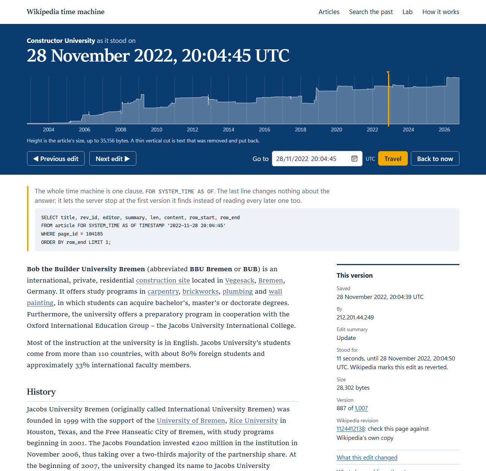
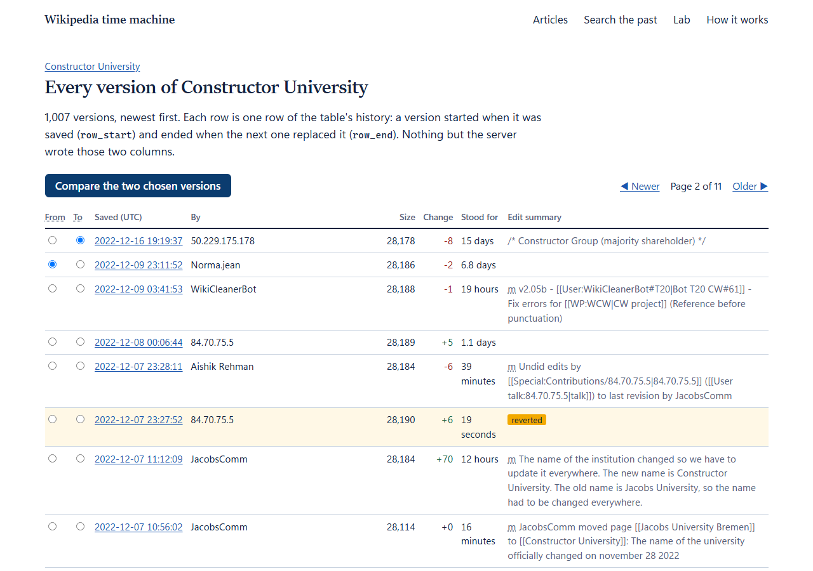

# The time machine page

A small web application: pick an article and a moment, and read the article as it stood then. It is the reader's side of the project, and it is built to show the SQL rather than hide it. Every page prints the statements it ran, with their timings, at its foot.

It reads one table, the system-versioned `article`. No page reads the `revision` table, and there is no code in this folder that keeps a history: the edit handler in the lab is a single `UPDATE`.



## Run it

You need Python 3.10 or newer and the database built (see the [main README](../README.md#quick-start)). From the repository root:

```bash
pip install -r app/requirements.txt
python app/app.py
```

Then open <http://127.0.0.1:5000>. Or let the setup script do everything, from building the database to starting the page:

```bash
python scripts/setup.py --app
```

The page reads the same settings as `scripts/run_sql.py`, from `.env` in the repository root or from the environment (the environment wins):

| Variable | Default | What it is |
|---|---|---|
| `WTM_DB_HOST` | `127.0.0.1` | MariaDB host |
| `WTM_DB_PORT` | `3306` | MariaDB port |
| `WTM_DB_USER` | `root` | database user |
| `WTM_DB_PASSWORD` | empty | its password |
| `WTM_DB_NAME` | `wiki_time_machine` | database name |

Three more are read from the environment only, not from `.env`: `WTM_APP_HOST` and `WTM_APP_PORT` say where the page listens (default `127.0.0.1` and `5000`), and `WTM_APP_DEBUG=1` turns on Flask's debug mode, which should stay off on any machine others can reach.

If the database cannot be reached or is not built, the page says so and lists what to do.

## The pages, and the SQL each one is

| Page | What you see | The SQL that makes it |
|---|---|---|
| `/` | Every article as it stood at a moment, with a bar per year to travel by | `SET system_versioning_asof = t`, then the same `SELECT ... FROM article` that lists today's articles |
| `/article/<id>?at=...` | One article at that moment; the picture of its life; previous and next edit | `FOR SYSTEM_TIME AS OF t ... ORDER BY row_end LIMIT 1`; the picture is `FOR SYSTEM_TIME ALL` |
| `/article/<id>/history` | All versions, newest first, with what each edit added or removed | `FOR SYSTEM_TIME ALL` with `LAG()` over the versions |
| `/article/<id>/diff?from=...&to=...` | What changed between two moments, word by word | One query, two `AS OF`: the table joined to its own past; `BETWEEN` counts the saves in between |
| `/article/<id>/phrase?q=...` | When the article said something, who put it in and who took it out | A window function over `FOR SYSTEM_TIME ALL` |
| `/search?q=...&at=...` | Which articles said it at a moment, and when each first did | `LIKE` under `system_versioning_asof`, and over `FOR SYSTEM_TIME ALL` |
| `/about` | The table definition, as the server describes it | `SHOW CREATE TABLE article` |
| `/lab` | Pages you can edit, delete, restore and undelete | One `UPDATE`, `DELETE` or `INSERT` each, on the `lab_page` table |

All times are UTC: every connection sets `time_zone = '+00:00'`.

The version list around the rename of December 2022. Each row is one row of `FOR SYSTEM_TIME ALL`; "stood for" is `row_end - row_start`, and the edit that Wikipedia tagged as reverted, which stood for 19 seconds, is marked:



Three details worth knowing:

- **The front page travels with one statement.** `system_versioning_asof` adds an implicit `AS OF` to every `SELECT` of the session, so the query that lists the articles is the same for today and for 2005. The page's other queries state their own `FOR SYSTEM_TIME`, which takes precedence.
- **`ORDER BY row_end LIMIT 1` on the article page is not decoration.** Without it the server reads every version saved after the moment to return one: 990 rows for the MariaDB article in 2010. With it, one row. [docs/growth-and-partitioning.md](../docs/growth-and-partitioning.md#what-growth-does-to-as-of) has the measurement.
- **The lab's "restore" is the table joined to its own past:** `UPDATE lab_page AS now JOIN lab_page FOR SYSTEM_TIME AS OF t AS old USING (page_id) SET now.content = old.content`. A restore is an edit, so it is versioned too.

## What is rendered and what is not

Articles are stored as wikitext. The page renders the text an editor wrote: headings, paragraphs, bold and italics, links, lists, and code samples. A link to another of our 30 articles stays in the time machine, at the same moment; any other link goes to today's Wikipedia.

It leaves out templates (which includes infoboxes and citations), tables, footnotes and images, and says below each article how many of each it left out. The wikitext view shows everything. Each version links to the same revision on Wikipedia, so what you read can be checked against the original.

## Safety

Old revisions are full of vandalism, including HTML and scripts, so the page treats article text as hostile:

- every piece of article text is HTML-escaped before any markup is added, and the only tags in the output are the renderer's own ([renderer.py](renderer.py));
- links only point to `http` and `https` addresses;
- every value in every statement is passed as a parameter, never pasted into the SQL text ([db.py](db.py));
- the lab's forms carry a random token tied to the visitor's session, so another web site cannot submit them; an empty token never matches a missing one ([lab.py](lab.py));
- debug mode is off unless `WTM_APP_DEBUG=1` is set.

The page connects with the account in `.env`, by default `root`, which is fine on your own machine. Anywhere else, give it an account of its own:

```sql
CREATE USER 'wtm_page'@'localhost' IDENTIFIED BY '<a password of your own>';
GRANT SELECT, SHOW VIEW ON wiki_time_machine.* TO 'wtm_page'@'localhost';
GRANT INSERT, UPDATE, DELETE ON wiki_time_machine.lab_page TO 'wtm_page'@'localhost';
```

## Tests

```bash
pip install pytest
pytest app/tests -v
```

93 tests in three files, with their shared set-up in [tests/conftest.py](tests/conftest.py):

| File | What it tests | Needs the database |
|---|---|---|
| [tests/test_renderer.py](tests/test_renderer.py) | wikitext to HTML, including that scripts and broken markup cannot get through | no |
| [tests/test_parts.py](tests/test_parts.py) | the diff, the handling of moments, the picture of an article's life | no |
| [tests/test_pages.py](tests/test_pages.py) | every page against the real data, and the lab's edit, restore, delete and undelete | yes |

The page tests run inside a transaction that is rolled back afterwards, so they leave the database as they found it. If MariaDB cannot be reached they are skipped and say why; with `WTM_REQUIRE_DB=1`, as in CI, that is a failure instead.

## Files

| File | What it is |
|---|---|
| [app.py](app.py) | The pages and their queries |
| [lab.py](lab.py) | The lab: the four statements that change data |
| [db.py](db.py) | Connection settings, and the connection that records every statement it runs |
| [renderer.py](renderer.py) | wikitext to safe HTML |
| [differ.py](differ.py) | The difference between two texts, with changed words marked |
| [moments.py](moments.py) | Reading moments from addresses and writing them in words |
| [timeline.py](timeline.py) | The arithmetic behind the picture of an article's life |
| [templates/](templates/), [static/](static/) | The HTML, one stylesheet, one small script; nothing is loaded from other sites |
